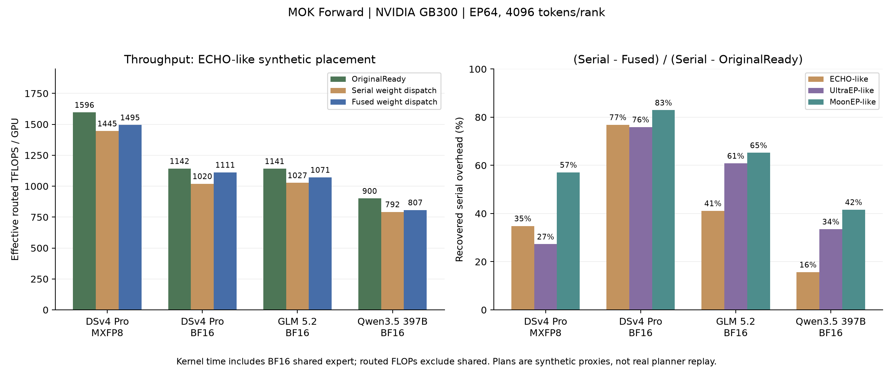

# MOK Forward 原版与权重通信融合版

本报告比较相同物理 token plan 下的原版 OriginalReady、Serial 和 Fused。默认分享版本是已验证的粗粒度 TMA pull 实现：先派发一批 home token，再复制 replica 权重，随后派发其余 token；shared/home 计算与复制并行。

## 计时和吞吐定义

OriginalReady 使用原 MOK 计算内核，replica 权重已就绪。Serial 为本 rank 完成权重复制后执行原 MOK，不额外增加全局权重 barrier。Fused 在 MOK 通信 CTA 中完成复制。OriginalReady 并不表示关闭负载均衡；三者使用同一个 physical plan。

计时只含 Forward MegaKernel，以及 Serial 的权重复制：保留内核内 token dispatch/combine、shared expert、激活处理与训练 context 保存；排除 router/schedule、权重量化与 swizzle、源权重发布、workspace reset 和外部 forward epilogue。数值采用每个样本的 rank 最大值，再取样本中位数和各轮中位数。

```text
T: 每 rank 输入 tokens；K: top-k；H: hidden；I: routed intermediate
本 fixture 有一个 intermediate 同为 I 的 BF16 shared expert。
routed FLOPs = 6*T*K*H*I
all MLP FLOPs = 6*T*(K+1)*H*I
TFLOPS = FLOPs / (time_ms * 1e9)
```

主表用 routed FLOPs / 整个 MOK kernel 时间，便于核对此前 routed 吞吐口径；它没有从 MOK 时间中扣除 shared。CSV 另列包含 shared 的 all_mlp_tflops。MXFP8 情况的 shared 是 BF16，因此总 MLP TFLOPS 是混合精度有效指标。

## 有效隐藏比例

```text
R = 最佳 OriginalReady；S = 最佳 Serial；F = 最佳 Fused
新增串行开销 = S-R
有效隐藏比例 = (S-F)/(S-R)
暴露比例 = (F-R)/(S-R)
融合相对 Serial 的净节省 = (S-F)/S
```

该比例表示回收了多少端到端串行增量，包含重新调节通信 SM 的效果，不是时间线上的物理重叠比例。CSV 同时给出固定在最佳 Fused SM 数下的 hidden_same_sm_pct。Copy-only 不能直接加到 OriginalReady：稀疏收发时，零接收 rank 可以计算并服务别人的 pull。比例不做 0/100 截断。

## 实测结果

| 模型 | 精度 | 合成 plan | 原版 ms | Serial ms | Fused ms | 原版 routed TFLOPS | Fused routed TFLOPS | 隐藏 | 暴露 | 净节省 |
|---|---|---|---:|---:|---:|---:|---:|---:|---:|---:|
| dsv4_pro | BF16 | ECHO | 2.8425 | 3.1846 | 2.9217 | 1142 | 1111 | 76.8% | 23.2% | 8.26% |
| dsv4_pro | BF16 | MoonEP | 2.8549 | 3.4406 | 2.9550 | 1137 | 1099 | 82.9% | 17.1% | 14.11% |
| dsv4_pro | BF16 | UltraEP | 2.8401 | 3.0843 | 2.8989 | 1143 | 1120 | 75.9% | 24.1% | 6.01% |
| dsv4_pro | MXFP8 | ECHO | 2.0346 | 2.2463 | 2.1726 | 1596 | 1495 | 34.8% | 65.2% | 3.28% |
| dsv4_pro | MXFP8 | MoonEP | 2.0372 | 2.4055 | 2.1953 | 1594 | 1479 | 57.1% | 42.9% | 8.74% |
| dsv4_pro | MXFP8 | UltraEP | 2.0333 | 2.1965 | 2.1520 | 1597 | 1509 | 27.3% | 72.7% | 2.03% |
| glm52 | BF16 | ECHO | 2.1683 | 2.4095 | 2.3104 | 1141 | 1071 | 41.1% | 58.9% | 4.12% |
| glm52 | BF16 | MoonEP | 2.1612 | 2.5649 | 2.3017 | 1145 | 1075 | 65.2% | 34.8% | 10.26% |
| glm52 | BF16 | UltraEP | 2.1651 | 2.3383 | 2.2329 | 1143 | 1108 | 60.8% | 39.2% | 4.51% |
| qwen35_397b | BF16 | ECHO | 1.1447 | 1.3015 | 1.2770 | 900 | 807 | 15.6% | 84.4% | 1.88% |
| qwen35_397b | BF16 | MoonEP | 1.1456 | 1.3496 | 1.2647 | 900 | 815 | 41.6% | 58.4% | 6.29% |
| qwen35_397b | BF16 | UltraEP | 1.1453 | 1.2442 | 1.2110 | 900 | 851 | 33.5% | 66.5% | 2.66% |




## 范围和复现条件

历史报告来自 OCI AGA GB300、EP64/4K 的既有正式运行（811385）；每 rank 的 post-plan routed token 工作均衡，minibatch4096、单 macrobatch，50 warmup、100 samples、3 rounds。源码包重建不会自动产生新的 EP64 性能结论。

ECHO/UltraEP/MoonEP 标签表示按同事 DSv3 MLPerf EP32 截图边缘分布构造的 EP64 合成近似，不是真实 planner replay，不能用于给三个 planner 排名。所有 active replicas 每次调用都重传，收发边、fan-out 和 token 分配均见所附 plan 与假设。

源权重已预先发布到对称内存；普通训练权重到对称 bank 的拷贝/量化不包含在数据内。Forward 权重使用 BF16 或 MXFP8 rowwise data+swizzled scales，源端真实供数包含在复制中。MXFP8 columnwise 空间保留但 Forward 不传，不应直接复用该 replica context 做 Backward。

当前是 Forward benchmark 原型，采用 capture/configure/launch 入口，尚不是直接替换 MCore autograd 的生产接口。不支持跨 NVLink domain；固定 home、固定最大 spare 容量、每 rank 最多8个 active replicas；默认只验证单 macrobatch、串行调用的生命周期。

[全部指标](metrics.csv) · [正确性检查](validation.json) · [成本记录](summary.md)
